# Lab 03 — Passos Detalhados: o complemento técnico do guia

> **Contoso RH** · Azure Day — Modernization Accelerator
> Stack: **Microsoft Fabric + OneLake** (+ Power BI, Copilot, Fabric Data Agent).
> Este documento **aprofunda** cada um dos 11 passos do lab: objetivo, pré-requisitos, ações detalhadas no Fabric, comandos/telas, **armadilhas comuns** e **critério de saída**.

> **Arquivos locais do lab:** as capturas de tela deste guia usam caminhos relativos para a pasta [`images/`](./images/), dentro de `labs/lab-03-dados/`. Os arquivos CSV ficam na pasta [`dados-contoso-rh/`](./dados-contoso-rh/), no mesmo diretório. Mantenha essa estrutura ao clonar ou baixar o repositório para que as imagens sejam exibidas corretamente.

---

## Passo 01 — Conheça o cenário

**Objetivo:** processar e organizar os dados de RH em um Lakehouse central, criar visualizações e relacionamentos entre os dados e habilitar o time de RH a consultar essas informações em linguagem natural por meio de recursos como o Fabric Data Agent.

**Pré-requisitos:**
- Ter lido `01-apresentacao-cenario.md` e `02-fonte-dados-contoso-rh.md`.
- Saber se você fez o **Lab 02** (terá bases reais para Mirroring) ou, caso não tenha feito, será necessário utilizar o **dataset raíz** localizado dentro da pasta: `dados-contoso-rh/`.

**Ações detalhadas:**
1. Identifique as três origens de dados do cenário: **Core**, **Folha de Pagamento** e **Reembolsos**.
2. Consulte em `02-fonte-dados-contoso-rh.md` as **10 tabelas** disponíveis e confirme que `Matricula` é a chave comum entre os módulos.
3. Entenda o fluxo que será construído: ingerir os dados no `ContosoRH_Lakehouse`, transformá-los nas camadas Bronze, Silver e Gold, criar um modelo semântico e um relatório, definir uma ontologia e disponibilizar consultas em linguagem natural com um Data Agent.

**Armadilhas comuns:**
- Confundir os 3 **bancos** (origens) com os 3 **ambientes** Fabric — é **1 só** workspace/Lakehouse de destino.
- Achar que precisa do Lab 02 para continuar: **não precisa** — o dataset raíz cobre tudo a partir do Passo 06/07.

**Critério de saída:** você sabe nomear os três módulos e explicar o fluxo do lab: centralizar e processar os dados, criar visualizações e relacionamentos de negócio e disponibilizar consultas em linguagem natural para o time de RH. **(~3 min)**

---

## Passo 02 — Prepare o ambiente Fabric

**Objetivo:** ter um workspace do Fabric, com **capacity** ativa.

**Pré-requisitos:**
- Conta com acesso ao **portal do Microsoft Fabric** (`app.fabric.microsoft.com`).
- Uma **capacity** atribuível: Fabric **Trial** (60 dias) ou uma **F SKU** (F2+). Sem uma Fabric capacity, itens Fabric não rodam, apenas Power BI items irão funcionar em capacidades Premium, por exemplo.

**Ações detalhadas:**
1. Acesse o portal (`app.fabric.microsoft.com`) e, na parte superior direita clique no seletor de conta, confirme se há **Trial** ativo. Se não houver, será necessário fazer a ativação/compra de uma **Fabric Capacity** no portal da Azure (`portal.azure.com`).

<p align="center">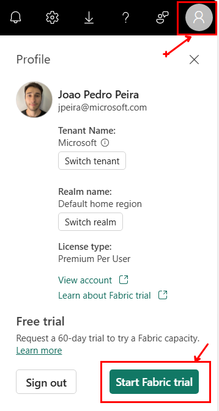</p>

2. Após a configuração/habilitação de uma Fabric Capacity, no canto inferior esquerdo, substitua a visão de Power BI para Fabric.

<p align="center">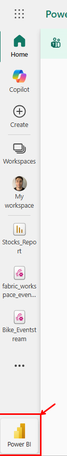</p>

3. Crie um **workspace**: **Workspaces → New workspace** → nome **`Contoso-RH-Lab03`**. No momento da criação, escolha o **tipo de workspace** de acordo com o que você habilitou no passo anterior: se você ativou a **Fabric Trial**, selecione **Fabric Trial**; se você fez a **ativação de uma capacidade no portal da Azure**, selecione **Fabric** e, em **Details**, escolha a sua **capacity** correspondente na lista (imagem 2). Essa escolha define qual capacity sustentará os itens do workspace.

<table>
  <tr>
    <td>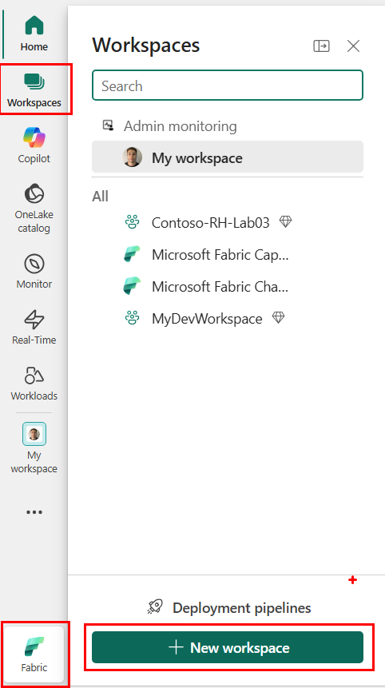</td>
    <td>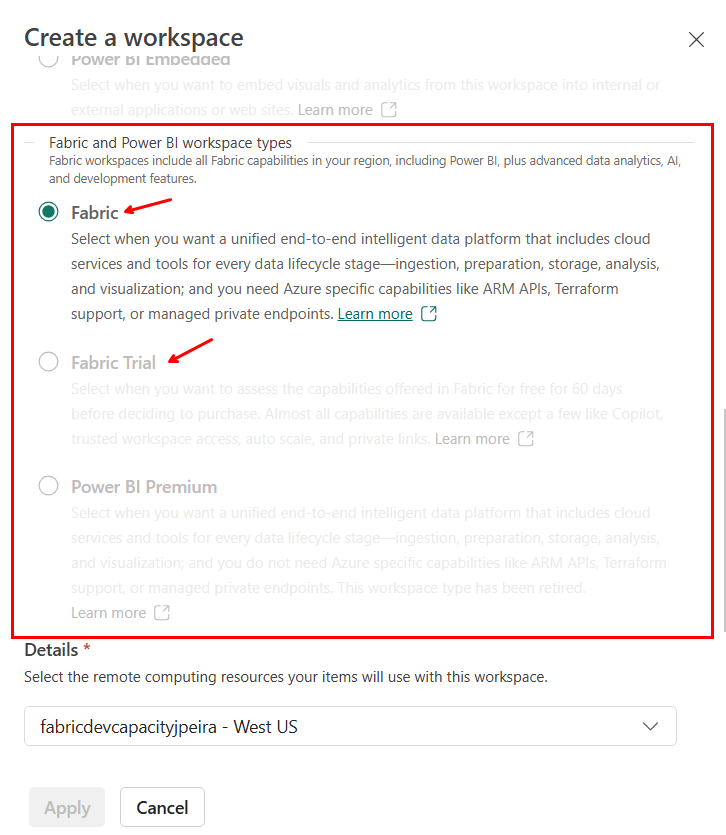</td>
  </tr>
  <tr>
    <td align="center"><em>Imagem 1 — New workspace</em></td>
    <td align="center"><em>Imagem 2 — Tipo de workspace + capacity</em></td>
  </tr>
</table>

4. Visualize os itens na interface padrão do Fabric: confira o **menu lateral** com **OneLake**, **Real-Time**, entre outros. O **OneLake** já vem habilitado por padrão no tenant — não há nada a provisionar.

**Armadilhas comuns:**
- Workspace criado em modo **Pro/PPU** (sem Fabric capacity) → itens Fabric ficam indisponíveis. Verifique o **License mode**.
- Região da capacity diferente da região das bases de origem aumenta latência no Mirroring — use, quando possível, a **mesma região**.

**Critério de saída:** workspace `Contoso-RH-Lab03` ativo, com capacity associada. **(~5 min)**

---

## Passo 03 — Crie o Lakehouse

**Objetivo:** criar o destino central onde os 3 módulos convergem.

**Pré-requisitos:** workspace do Passo 02 ativo.

**Ações detalhadas:**
1. No workspace: **+ New Item→ Lakehouse** → nome **`ContosoRH_Lakehouse`**.

<table>
  <tr>
    <td>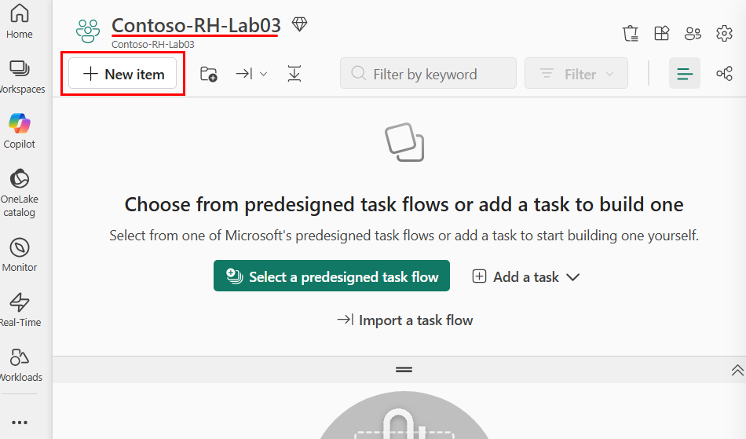</td>
    <td>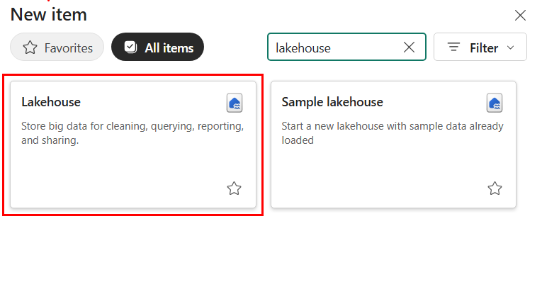</td>
  </tr>
  <tr>
    <td align="center"><em>Imagem 1 — New Item</em></td>
    <td align="center"><em>Imagem 2 — New Lakehouse</em></td>
  </tr>
</table>

2. Observe as duas áreas no explorer: **Tables** (Delta, gerenciado, com SQL endpoint) e **Files** (arquivos crus).
3. Habilite **schemas** para poder gerenciar e organizar suas "camadas" mais facilmente.
4. Planeje a convenção de nomes medallion (ex.: `bronze_core_colaboradores`, `silver_colaboradores`, `gold_dim_colaborador`) para os próximos passos.

**Armadilhas comuns:**
- Criar o Lakehouse no **workspace errado** (pessoal, sem capacity). Confirme o workspace no topo.
- Misturar **Tables** e **Files** sem critério — defina desde já: cru/landing/não-estruturado em **Files**, curado/estruturado em **Tables**.

**Critério de saída:** `ContosoRH_Lakehouse` criado, **vazio**, com a convenção medallion planejada. **(~4 min)**

---

## Passo 04 — Decida a ingestão (ETL × Mirroring)

**Objetivo:** escolher conscientemente como trazer os dados — e **justificar**.

**Pré-requisitos:** entender a natureza das origens (Azure SQL + 2× PostgreSQL) e ter clareza do que é Bronze vs. Silver/Gold.

**Ações detalhadas:**
1. Releia a tabela comparativa do guia (Mirroring replica cru → Bronze, sem compute; ETL transforma → Silver/Gold).
2. Aplique a **regra estratégica**: **Mirroring para ingerir (Bronze)**, **ETL para curar (Silver/Gold)**.
3. **Registre a decisão** para as próximas etapas.

**Armadilhas comuns:**
- Tratar como **ou/ou**: na arquitetura recomendada os dois **coexistem** (Mirroring ingere, ETL cura).
- Assumir que Mirroring transforma — ele **não** mascara CPF/Salário; isso é trabalho do ETL/Notebook na Silver.

**Critério de saída:** decisão documentada — *Mirroring para ingerir, ETL para curar*. **(~5 min)**

---

## Passo 05 — Ingestão de bancos de dados (Caso o lab anterior tenha sido realizado)

> ⚠️ **Disclaimer:** este passo depende das bases provisionadas no **Lab 02**. Caso você **não** tenha realizado o lab anterior, **pule este passo e siga direto para o [Passo 06](#passo-06--ingestão-por-etlpipeline-alternativa)**, onde trabalharemos com **arquivos locais** (dataset raíz) em vez de conectar aos bancos de dados.

**Objetivo:** trazer os **3 cenários** para a **Bronze**. **Aqui os 3 módulos entram no cérebro.**

> **Este passo tem dois documentos dedicados — escolha sua trilha:**
> - **`05-ingestao-mirroring.md`** ← **trilha principal** (Mirrored Database por banco, CDC, validação no OneLake).
> - **`06-ingestao-etl.md`** ← **trilha comparativa** (Dataflow Gen2 / Data Factory; também serve ao dataset raíz).

**Resumo das ações (detalhe nos docs 05/06):**
1. **Cenário A — Core (Azure SQL Database):** Mirrored Database → `Colaboradores`, `Ferias`, `Tickets`, `Beneficios`.
2. **Cenário B — Folha (Azure Database for PostgreSQL):** Mirrored Database → `Holerites`, `IRRF`, `Encargos`, `Provisoes`.
3. **Cenário C — Reembolsos (PostgreSQL Flexible Server):** Mirrored Database → `Reembolsos`, `Aprovacoes`.
4. Consolide via **shortcuts** na área Bronze do `ContosoRH_Lakehouse`.

**Armadilhas comuns:** ver docs 05 e 06 (Managed Identity, CDC, conectividade, firewall).

**Critério de saída:** as **10 tabelas dos 3 módulos** visíveis na Bronze do Lakehouse. **(~12 min)**

---

## Passo 06 — Ingestão por ETL/Pipeline (alternativa)

**Objetivo:** caminho alternativo para quem não realizou o Lab02 — os dados serão carregados diretamente ao Lakehouse.

**Pré-requisitos:** Lakehouse criado; acesso ao **dataset raíz** `dados-contoso-rh/`.

**Ações detalhadas (resumo):**
1. Abra o `ContosoRH_Lakehouse` e, na tela **Get data in your lakehouse**, clique em **Upload files / Carregar arquivos** para enviar os dados diretamente da sua máquina local.

<p align="center">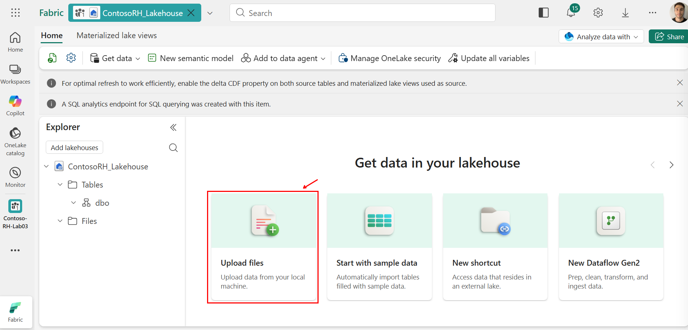</p>

2. Selecione os arquivos **CSV** que estão na pasta `lab-03-dados/dados-contoso-rh/` e faça o upload. **Não carregue** o arquivo `README.md` presente nesse diretório — apenas os `.csv`.
3. Após o upload, valide que os arquivos aparecem corretamente em **Files** no explorer do Lakehouse.

<p align="center">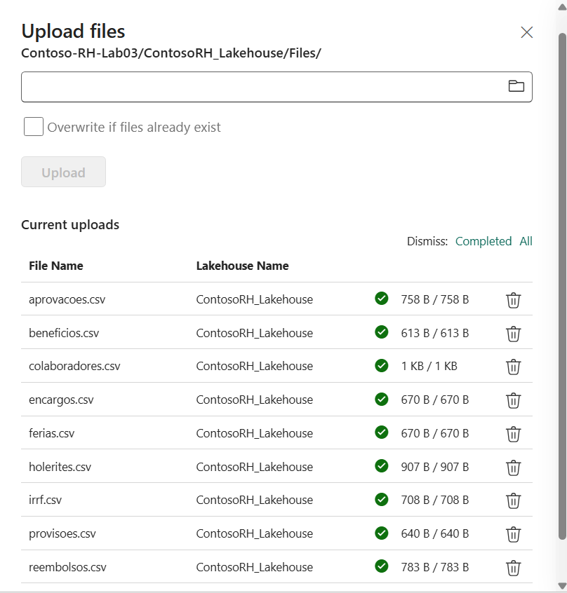</p>

4. Após o upload, na seção **Explorer** (lado esquerdo), clique em **Files** para pré-visualizar os arquivos carregados. **Obs.:** clique diretamente no **ícone/texto Files** — e **não** na setinha (`>`) à esquerda de **Files**.

**Armadilhas comuns:**
- Subir o `README.md` (ou outros arquivos não-CSV) junto com os dados → carregue **apenas os `.csv`** da pasta `dados-contoso-rh/`.
- Deixar os arquivos apenas em **Files** sem fazer o **load-to-tables** → os dados ficam fora de **Tables** e sem **SQL endpoint** para consulta.


**Critério de saída:** 10 tabelas na Bronze via pipeline, com `Matricula` consistente. **(~8 min)**

---

## Passo 07 — Transformando arquivos e criando estruturas de tabela

**Objetivo:** carregar os arquivos que subimos em **CSV** para **tabelas Delta** (dados estruturados) no Lakehouse.

**Pré-requisitos:** 10 arquivos CSV carregados em **Files** (via Passo 05 ou 06).

**Ações detalhadas:**
1. **Crie os schemas medallion:** em **Explorer → Tables**, clique nos **"..."** ao lado de **Tables** e escolha **New schema**. Crie **3 schemas**: `bronze`, `silver` e `gold`.

<p align="center">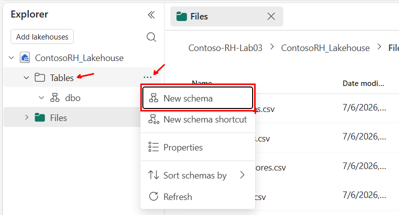</p>

2. **Carregue os arquivos CSV:** em **Files**, clique nos **"..."** ao lado do nome do arquivo e escolha **Load to Tables → New table**.

<p align="center">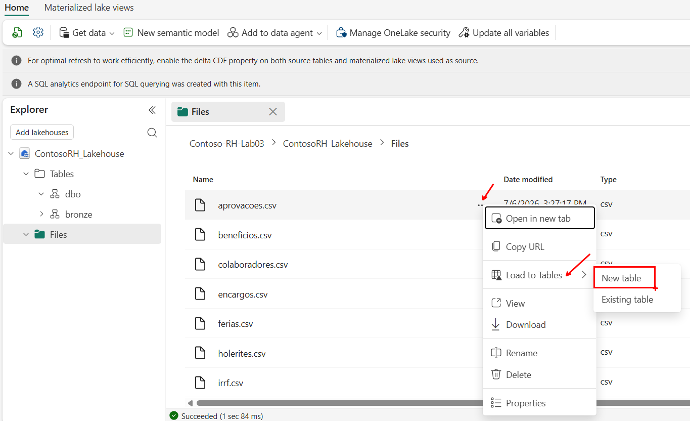</p>

3. **Configure o carregamento:** na janela **Load file to new table**, mantenha o **nome da tabela** (vem pré-preenchido com o nome do arquivo) e altere apenas o **Schema**, escolhendo **`bronze`**. Mantenha as demais opções no padrão e clique em **Load**.

<p align="center">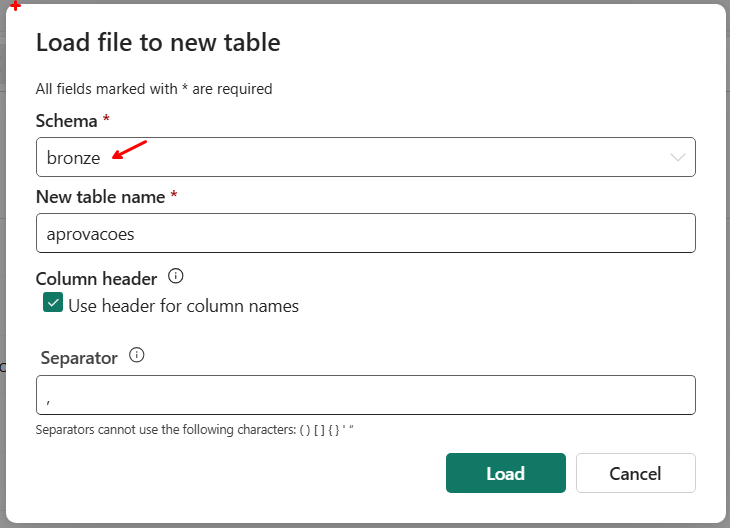</p>

4. **Valide** se a tabela foi criada corretamente dentro do schema **`bronze`**. Isso pode levar de alguns segundos a alguns minutos.
5. **Repita** o processo (itens 2 a 4) para os **10 arquivos** existentes.

**Armadilhas comuns:**
- Esquecer de trocar o **Schema** para `bronze` e deixar no padrão (`dbo`) → mantenha a organização medallion desde o carregamento.
- Interromper antes do fim do processamento → a tabela Delta pode levar alguns minutos para aparecer; aguarde a confirmação.

**Critério de saída:** as **10 tabelas** carregadas como **Delta** no schema **`bronze`** do `ContosoRH_Lakehouse`. **(~10 min)**

---

## Passo 08 — Modele em medallion (Bronze → Silver → Gold)

**Objetivo:** transformar os dados que estão no schema **`bronze`** para os schemas **`silver`** e, posteriormente, **`gold`**.

**Pré-requisitos:** 10 tabelas na **Bronze** (via Passo 07).

**Ações detalhadas:**
1. No canto superior direito, clique em **Analyze data with / Analisar dados com**. Serão apresentadas 3 formas de analisar/transformar os dados:

<p align="center">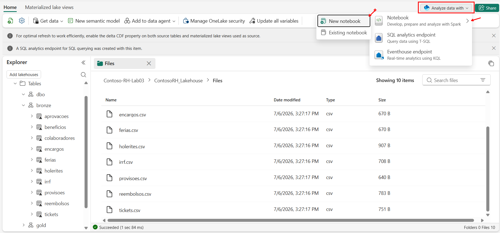</p>

   - **Notebook** — desenvolva, prepare e analise os dados com **Spark** (PySpark, Spark SQL, etc.). Ideal para as transformações medallion (Bronze → Silver → Gold) com código.
   - **SQL analytics endpoint** — consulte os dados via **T-SQL**, sobre as tabelas Delta já expostas pelo Lakehouse. Bom para exploração e queries analíticas relacionais.
   - **Eventhouse endpoint** — análise em **tempo real** usando **KQL** (Kusto Query Language), voltada a cenários de telemetria/streaming.

2. Crie um novo notebook: **Analyze data with → Notebook → New notebook**. Nomeie o notebook como **`ContosoRH_Notebook`**.
3. No notebook, expanda o menu **OneLake** (lado esquerdo) e visualize as tabelas e os schemas (`bronze`, `silver`, `gold`) criados anteriormente.

<p align="center">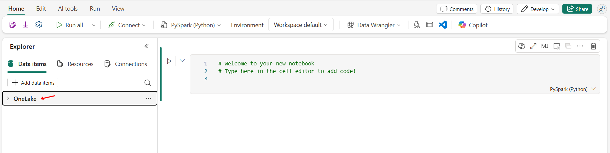</p>

4. Em uma célula do notebook, execute o código abaixo. Ele percorre **todas as tabelas do schema `bronze`**, aplica transformações padrão (remoção de duplicatas, linhas totalmente nulas, chaves vazias e espaços em branco) e **cria/popula as tabelas correspondentes no schema `silver`** — exemplificando a passagem de camada **Bronze → Silver**.

```python
from pyspark.sql.functions import col, trim

# EXEMPLO BRONZE → SILVER
# Este código percorre TODAS as tabelas do schema bronze e cria versões tratadas no schema silver com o MESMO nome.

# 1. Listar tabelas do schema bronze
bronze_tables_df = spark.sql("SHOW TABLES IN bronze")
bronze_tables = [row.tableName for row in bronze_tables_df.collect()]

print("Tabelas encontradas no schema bronze:")
for t in bronze_tables:
    print(f" - {t}")

# 2. Função auxiliar para aplicar transformações padrão em um DataFrame

def transformar_para_silver(df):
    # 2.1 Remover linhas totalmente duplicadas
    df_silver = df.dropDuplicates()

    # 2.2 Remover linhas onde TODAS as colunas são nulas
    cond_not_all_null = None
    for c in df_silver.columns:
        expr = col(c).isNotNull()
        cond_not_all_null = expr if cond_not_all_null is None else (cond_not_all_null | expr)
    if cond_not_all_null is not None:
        df_silver = df_silver.filter(cond_not_all_null)

    # 2.3 Remover linhas com chaves vazias/nulas (colunas que contenham 'id' no nome)
    key_cols = [c for c in df_silver.columns if "id" in c.lower()]
    for k in key_cols:
        df_silver = df_silver.filter(col(k).isNotNull())

    # 2.4 Remover espaços em branco nas colunas texto (string)
    for field in df_silver.schema.fields:
        if str(field.dataType) == "StringType":
            df_silver = df_silver.withColumn(field.name, trim(col(field.name)))

    return df_silver

# 3. Loop em todas as tabelas do bronze e grava no silver

for table_name in bronze_tables:
    bronze_full_name = f"bronze.{table_name}"
    silver_full_name = f"silver.{table_name}"

    print(f"\nProcessando tabela: {bronze_full_name} -> {silver_full_name}")

    # Ler tabela do bronze
    df_bronze = spark.table(bronze_full_name)

    # Aplicar transformações padrão
    df_silver = transformar_para_silver(df_bronze)

    # Gravar no schema silver (overwrite, pois é laboratório controlado)
    df_silver.write.mode("overwrite").saveAsTable(silver_full_name)
    print(f"Tabela gravada no silver: {silver_full_name}")

# 4. Exemplo de visualização: mostrar 10 linhas da tabela 'colaboradores' no silver, se existir

if "colaboradores" in bronze_tables:
    display(spark.table("silver.colaboradores").limit(10))
else:
    # Se não houver "colaboradores", mostra a primeira tabela que estiver no bronze
    if bronze_tables:
        first_table = bronze_tables[0]
        display(spark.table(f"silver.{first_table}").limit(10))
```

5. Ao final da célula que você usou para transformar **Bronze → Silver**, clique em **+ Code** para adicionar uma nova célula de código, conforme a imagem.

<p align="center">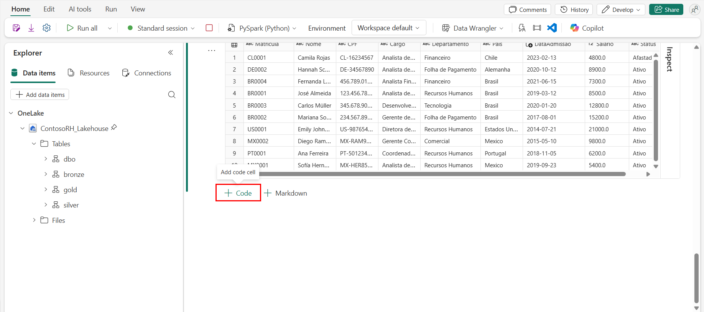</p>

6. Na nova célula, execute o código abaixo. Ele lê as tabelas da camada **`silver`** e cria as **dimensões e fatos** na camada **`gold`**, montando o modelo analítico que será consumido pelo Power BI.

```python
from pyspark.sql.functions import col, year, month, concat_ws, to_date

# CAMADA GOLD – MODELO ANALÍTICO PARA POWER BI
# Lê tabelas da camada SILVER e cria dimensões e fatos na camada GOLD.

# 1. DIMENSÃO DE COLABORADORES
#    Usa colunas reais de silver.colaboradores.

df_colab_silver = spark.table("silver.colaboradores")
print("Schema de silver.colaboradores:")
df_colab_silver.printSchema()

# Vamos usar Matricula como chave de negócio e criar um ID analítico baseado nela

dim_colab = (
    df_colab_silver
        .select(
            col("Matricula").alias("colaborador_id"),  # chave para fato
            col("Matricula"),
            col("Nome"),
            col("CPF"),
            col("Cargo"),
            col("Departamento"),
            col("Pais"),
            col("DataAdmissao"),
            col("Salario"),
            col("Status")
        )
        .dropDuplicates(["colaborador_id"])
)

# Grava dimensão (sobrescrevendo schema, pois é laboratório)
(
    dim_colab
        .write
        .mode("overwrite")
        .option("overwriteSchema", "true")
        .saveAsTable("gold.dim_colaborador")
)
print("Tabela criada/atualizada: gold.dim_colaborador")

# 2. DIMENSÃO DE TEMPO
#    Usa as datas de pagamento da folha (silver.holerites) para gerar calendário mínimo.

folha_silver = spark.table("silver.holerites")
print("Colunas disponíveis em silver.holerites:", folha_silver.columns)

if "DataPagamento" in folha_silver.columns:
    dim_tempo = (
        folha_silver
            .select(to_date(col("DataPagamento")).alias("data"))
            .dropna()
            .dropDuplicates()
            .withColumn("ano", year(col("data")))
            .withColumn("mes", month(col("data")))
            .withColumn("ano_mes", concat_ws("-", col("ano"), col("mes")))
            .withColumn("data_id", col("data"))
    )

    dim_tempo.write.mode("overwrite").saveAsTable("gold.dim_tempo")
    print("Tabela criada/atualizada: gold.dim_tempo")
else:
    print("ATENÇÃO: coluna 'DataPagamento' não encontrada em silver.holerites. Dimensão de tempo não foi gerada.")

# 3. FATO DE FOLHA DE PAGAMENTO
#    Fato simples para visualização no Power BI.

# A tabela de holerites usa Matricula como chave, vamos trazê-la e depois relacionar com a dimensão por colaborador_id (= Matricula)

fact_folha = (
    folha_silver
        .select(
            col("Matricula").alias("colaborador_id"),
            to_date(col("DataPagamento")).alias("data"),
            col("Competencia"),
            col("SalarioBruto").alias("salario_bruto"),
            col("Descontos").alias("descontos"),
            col("SalarioLiquido").alias("salario_liquido")
        )
        .withColumn("data_id", col("data"))
)

# Como é laboratório, vamos DROPAR a tabela antiga e recriar do zero para evitar conflitos de schema
spark.sql("DROP TABLE IF EXISTS gold.fact_folha_pagamento")

(
    fact_folha
        .write
        .mode("overwrite")
        .option("overwriteSchema", "true")
        .saveAsTable("gold.fact_folha_pagamento")
)

print("Tabela criada/atualizada: gold.fact_folha_pagamento")

# 4. VISUALIZAÇÃO RÁPIDA (AMOSTRA)
print("\nAmostra de gold.dim_colaborador:")
display(spark.table("gold.dim_colaborador").limit(10))

print("\nAmostra de gold.fact_folha_pagamento:")
display(spark.table("gold.fact_folha_pagamento").limit(10))
```

7. **Explore os recursos do notebook no Fabric.** Além de executar código, o notebook oferece integrações que aceleram a preparação dos dados:
   - **Data Wrangler** — interface visual para preparação/limpeza dos dados, gerando o código PySpark automaticamente.
   - **Integração com o VS Code** — edite e execute o notebook diretamente do seu ambiente local.
   - **Copilot** — a qualquer momento você pode conversar com o Copilot para **escrever código**, obter **recomendações**, sugerir **ações** e explicar transformações.

<p align="center">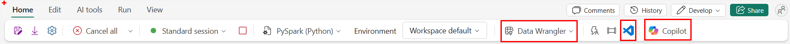</p>

**Armadilhas comuns:**
- Rodar a célula **Silver → Gold** antes de concluir a célula **Bronze → Silver** → as tabelas `silver.*` ainda não existem e o código falha.
- Referenciar colunas que não existem na origem (ex.: nomes diferentes em `silver.holerites`) → confira o `printSchema()`/`columns` antes de mapear dimensões e fatos.

**Critério de saída:** tabelas `silver.*` criadas a partir da `bronze`, e camada `gold` com dimensões e fatos materializados para consumo. **(~10 min)**

---

## Passo 09 — Modelo semântico e relatórios no Power BI

**Objetivo:** criar um **modelo semântico** a partir da camada **`gold`** que criamos e, na sequência, construir um **relatório/dashboard** para consumo.

**Pré-requisitos:** camada `gold` materializada (dimensões e fatos criados no Passo 08).

**Ações detalhadas:**
1. Volte ao **`ContosoRH_Lakehouse`** criado anteriormente e visualize os **schemas e tabelas** criados. Em seguida, clique em **New semantic model**.

<p align="center">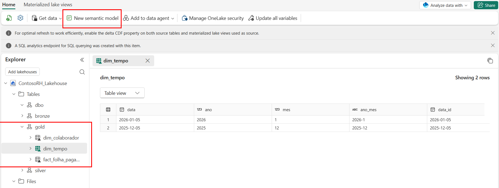</p>

2. Dê o nome **`ContosoRH_SemanticModel`** e selecione o schema **`gold`**, contendo as **3 tabelas** criadas no passo anterior (`dim_colaborador`, `dim_tempo`, `fact_folha_pagamento`).

<p align="center">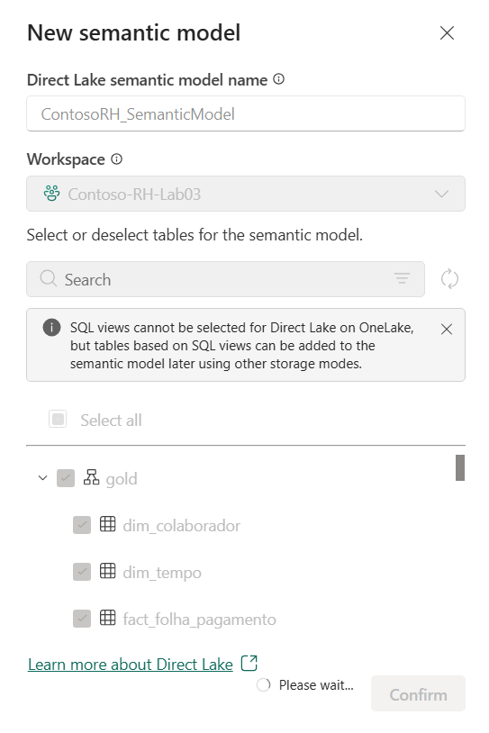</p>

3. Defina os **relacionamentos** entre as tabelas. Um **modelo semântico** é a camada de negócio que conecta dimensões e fatos: define os **relacionamentos** (ex.: `dim_colaborador` **1:N** `fact_folha_pagamento` pela chave `colaborador_id`), a **cardinalidade** (1:N, 1:1, N:N) e a **direção do filtro**. É isso que permite cruzar os dados corretamente nos relatórios.

   > 🤖 **Use o Copilot — isso é muito importante!** Você pode pedir, em **linguagem natural**, que o Copilot modele tudo para você. Exemplo de prompt:
   >
   > *"Modele as tabelas da melhor maneira possível pensando em relacionamentos, cardinalidade e outros aspectos."*
   >
   > Caso ele **não crie de imediato** e apenas descreva o raciocínio/plano de execução, peça na sequência para **executar**:
   >
   > *"Faça as alterações para mim, crie as relações para que eu possa criar um report/dashboard simples."*
   >
   > Caso você já tenha experiência, também é possível fazer manualmente no **Model view**.

<p align="center">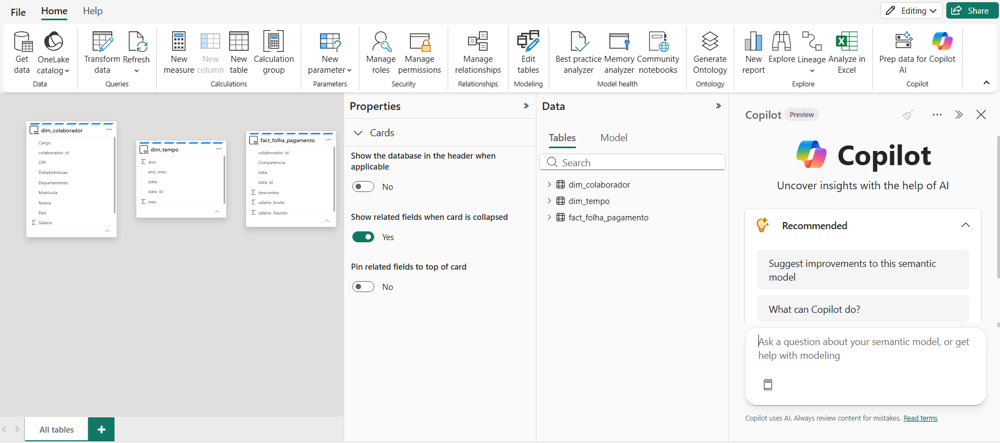</p>

4. (Opcional) Crie **medidas DAX** de negócio compatíveis com a camada `gold`, ex.: `Total Salário Bruto`, `Total de Descontos` e `Total Salário Líquido`.
5. **Crie o relatório/dashboard:** no menu superior, acesse **File → Create new report** para iniciar um novo relatório sobre o modelo semântico.

<p align="center">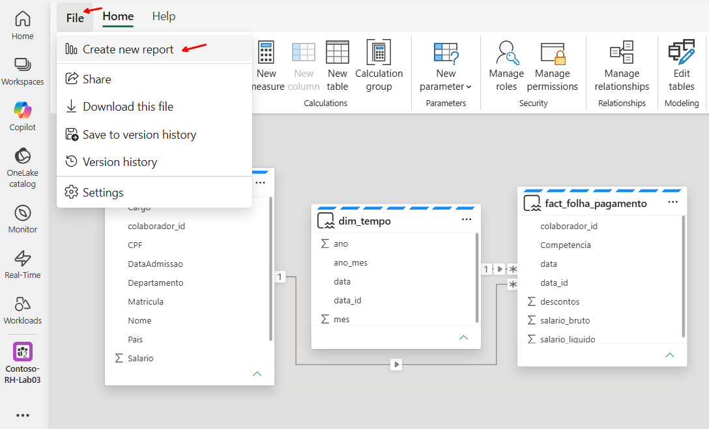</p>

6. **Use o Copilot para gerar as visualizações:** peça, em linguagem natural, que o Copilot crie as visualizações e monte a **visão 360 de RH** (KPI cards por País, drill por colaborador, etc.). Você também pode montar os visuais **manualmente**, arrastando os campos do modelo.

<p align="center">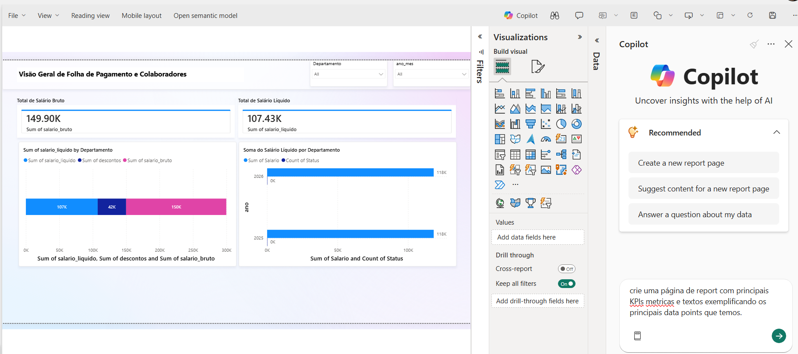</p>

7. **Salve o relatório:** no canto superior esquerdo, vá em **File → Save** e nomeie o relatório como **`ContosoRH_Report`**.

**Armadilhas comuns:**
- Relacionamentos **bidirecionais** desnecessários criam ambiguidade — mantenha **single direction** (dim → fato).
- Selecionar tabelas fora do schema `gold` (bronze/silver) no modelo → use apenas a camada **gold**, já curada e modelada.

**Critério de saída:** `ContosoRH_SemanticModel` publicado com relacionamentos definidos e um relatório/dashboard funcional sobre a camada gold. **(~10 min)**

---

## Passo 10 — Crie e consuma a ontologia da Contoso RH 🧠

**Objetivo:** criar uma **ontologia de negócio** diretamente a partir das três tabelas do schema `gold`, explorar suas entidades e relacionamentos como um grafo e consumi-la por meio de um **Fabric Data Agent**.

> **Importante:** Ontology e sua integração com agentes estão em **preview**. A interface e alguns nomes de menus podem mudar. Neste passo, criaremos a ontologia manualmente e vincularemos cada entidade às tabelas do `ContosoRH_Lakehouse`.

**Pré-requisitos:**
- As tabelas `gold.dim_colaborador`, `gold.dim_tempo` e `gold.fact_folha_pagamento` devem existir e conter dados no lakehouse `ContosoRH_Lakehouse`.
- As tabelas devem ser **gerenciadas pelo Lakehouse**. Tabelas externas não são suportadas pelo grafo da Ontologia.
- Um administrador do Fabric deve habilitar em **Admin portal → Tenant settings**:
  - **Enable Ontology item (preview)**;
  - **Users can use Copilot and other features powered by Azure OpenAI**;
  - as opções de processamento e armazenamento fora da região exigidas pelo Data Agent, quando aplicáveis ao seu tenant.

<p align="center">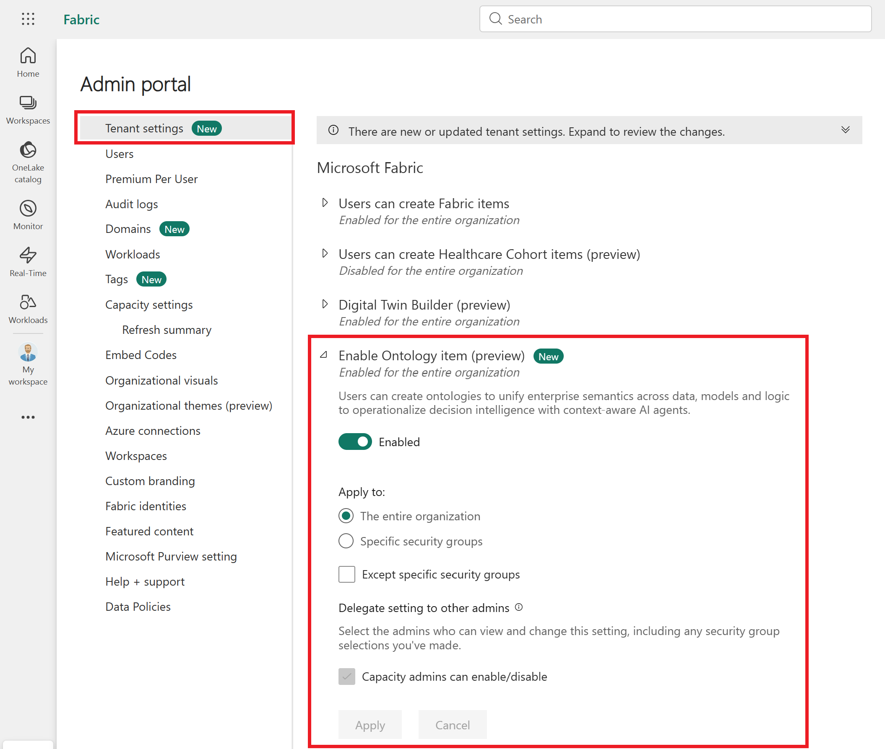</p>

### Etapa 1 — Criando a ontologia

#### 1. Crie o item de Ontologia

1. No workspace `Contoso-RH-Lab03`, selecione **+ New item**.
2. Pesquise por **Ontology (preview) / Ontologia (versão prévia)** e selecione o item.

<p align="center">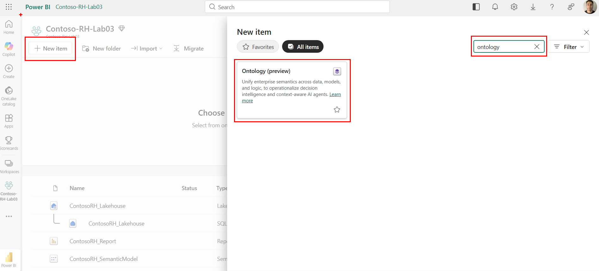</p>

3. Informe o nome **`ContosoRH_Ontology`** e selecione **Create**.

    > Nomes de ontologia podem usar letras, números e underscores (`_`). Não use espaços nem hífens.

<p align="center">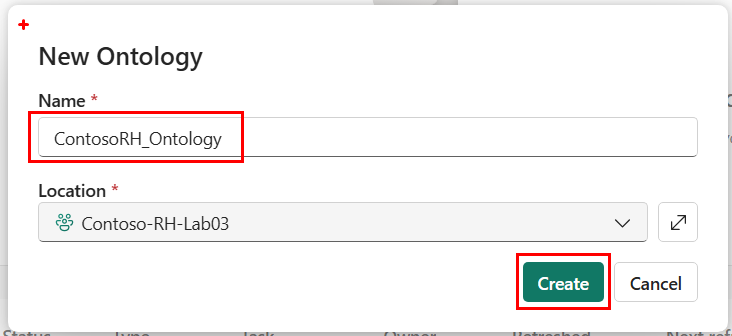</p>

4. Aguarde a criação. O canvas vazio da Ontologia será aberto automaticamente quando estiver pronto.

<p align="center">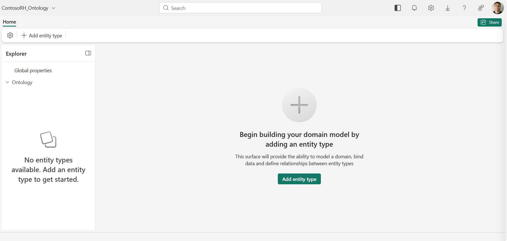</p>

#### 2. Crie e vincule a entidade Colaborador

Um **tipo de entidade** representa um conceito de negócio. O **data binding** conecta esse conceito a uma tabela real no OneLake e transforma cada linha da tabela em uma instância da entidade.

1. Na faixa superior ou no centro do canvas, selecione **Add entity type / Adicionar tipo de entidade**.

<p align="center">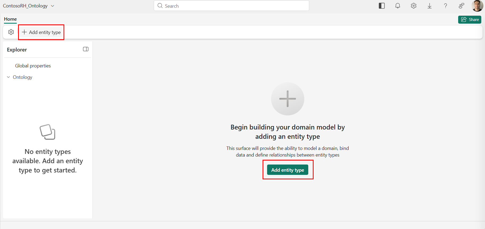</p>

2. Informe **`Colaborador`** e selecione **Add Entity Type**.

    > **Atenção:** confirme que não existe espaço em branco antes ou depois do nome `Colaborador`. Um espaço no final do nome causa erro e impede a criação da entidade.

3. No canvas, selecione **...** ao lado de `Colaborador` e escolha **Bind data / Vincular dados**.

<p align="center">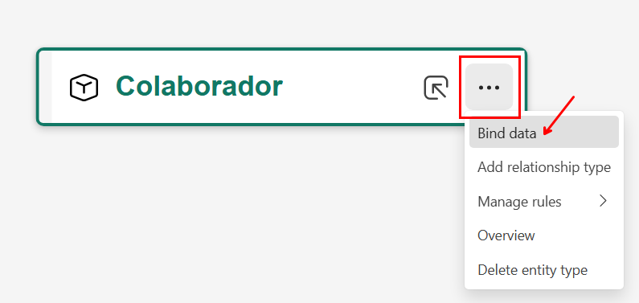</p>

4. Selecione **Add data binding → Lakehouse table**.

<p align="center">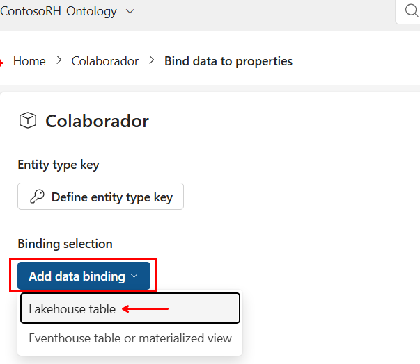</p>

5. Escolha o Lakehouse **`ContosoRH_Lakehouse`** e selecione **Next**.
6. Localize o schema `gold`, selecione a tabela **`dim_colaborador`** e escolha **Select**.

<p align="center">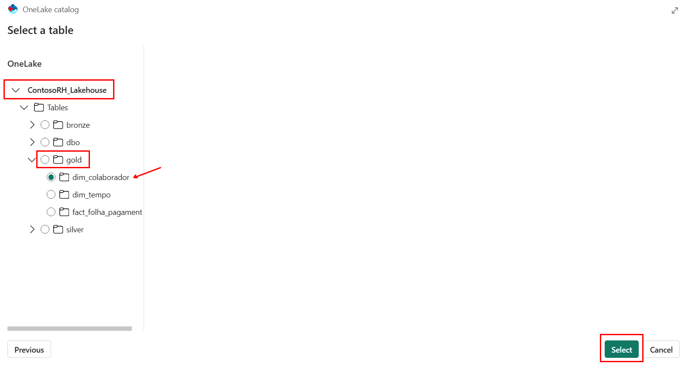</p>

7. Na configuração do binding, confira as seções:
    - **Entity type key** — identifica de forma única cada instância;
    - **Binding selection** — mostra a tabela de origem;
    - **Entity type key mapping** — associa a chave à coluna da tabela;
    - **Properties** — mapeia as demais colunas para propriedades da entidade.
8. Selecione **Define entity type key**, marque `colaborador_id` e selecione **Save**.
9. Mantenha os nomes padrão das demais propriedades e selecione **Save** para concluir o binding.

<p align="center">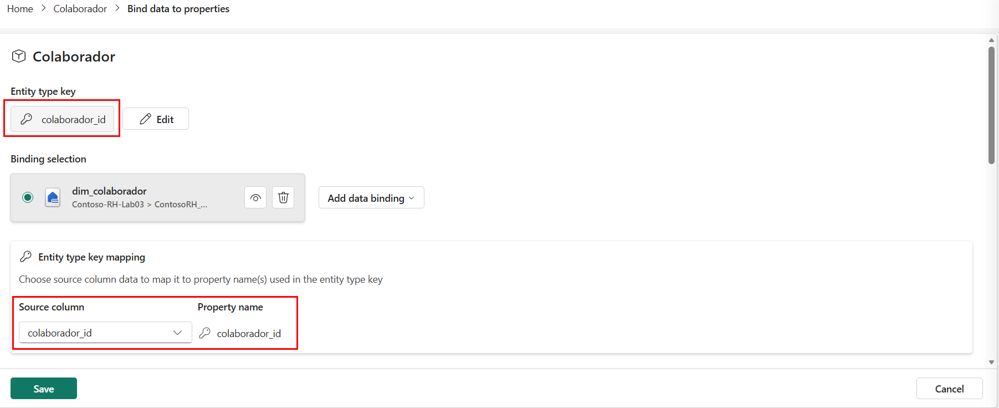</p>

10. Confirme a mensagem de atualização e selecione **Cancel** para fechar a configuração. Na página **Configure**, verifique se o data binding está listado.

<p align="center">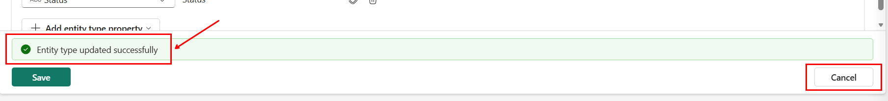</p>

#### 3. Crie e vincule as demais entidades

1. Selecione **Home** para retornar ao canvas.
2. Repita o processo de **Add entity type → Bind data → Lakehouse table** conforme a tabela abaixo.

| Entidade | Tabela no `ContosoRH_Lakehouse` | Chave da entidade | Representa |
| --- | --- | --- | --- |
| `DataPagamento` | `gold.dim_tempo` | `ano_mes` | O período em que a folha foi paga. |
| `FolhaPagamento` | `gold.fact_folha_pagamento` | `colaborador_id` | O pagamento de um colaborador em uma competência. |

> **Observação:** usamos `ano_mes` como chave de `DataPagamento` porque chaves da Ontologia devem usar colunas string ou inteiras. Para `FolhaPagamento`, selecione somente `colaborador_id` como **Entity type key**; `Competencia` permanece como propriedade da entidade.

3. Para `DataPagamento`, mantenha as propriedades `data`, `ano`, `mes`, `ano_mes` e `data_id`.
4. Para `FolhaPagamento`, mantenha `data`, `Competencia`, `salario_bruto`, `descontos`, `salario_liquido` e `data_id`.

5. Volte para **Home** e confirme que `Colaborador`, `DataPagamento` e `FolhaPagamento` aparecem no **Explorer**.

<p align="center">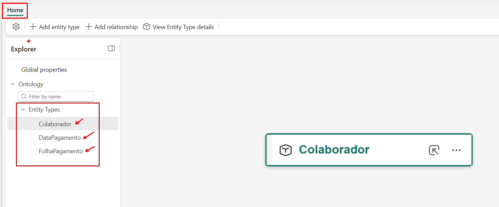</p>

#### 4. Crie os relacionamentos

Os relacionamentos representam, em linguagem de negócio, como as entidades se conectam. Cada relacionamento também precisa ser vinculado a uma tabela que contenha as chaves da origem e do destino.

1. No **Explorer**, selecione a entidade `FolhaPagamento`.
2. Na faixa superior, selecione **Add relationship**; alternativamente, no canvas, use **... → Add relationship type**.

<p align="center">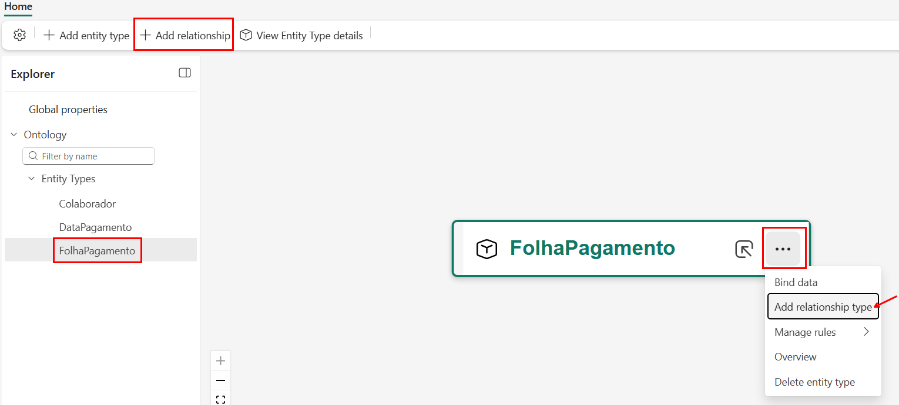</p>

3. Crie o primeiro relacionamento com estes valores:
    - **Relationship type name:** `pertence_a`;
    - **Origin entity type:** `FolhaPagamento`;
    - **Target entity type:** `Colaborador`.

<p align="center">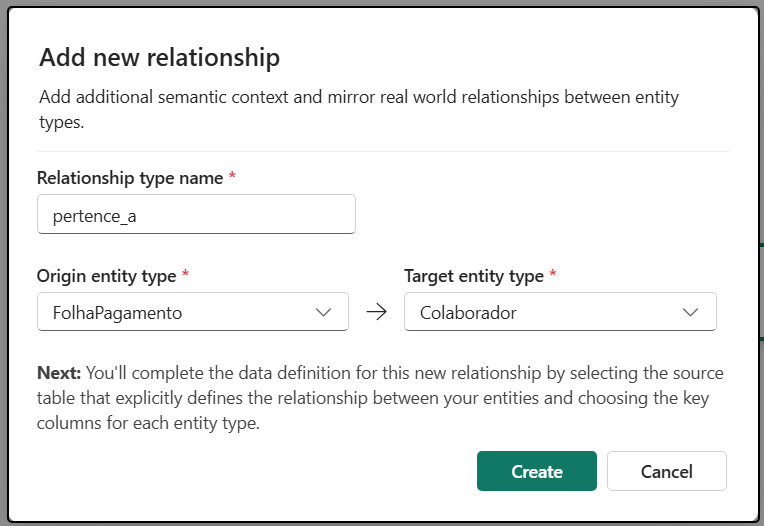</p>

4. Selecione **Create** e, no canvas, clique no relacionamento recém-criado para abrir sua configuração (`pertence_a`).
5. Em **Mapping table**, selecione **Browse available sources → ContosoRH_Lakehouse → gold.fact_folha_pagamento**.
6. Configure as colunas correspondentes conforme a primeira linha da tabela abaixo e salve.

<p align="center">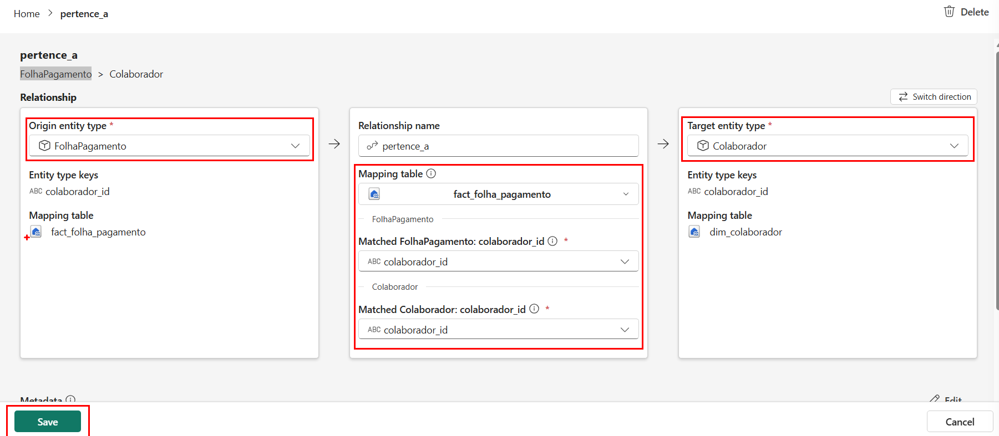</p>

7. Volte para **Home** e repita o processo para criar `ocorre_em`.

| Nome do relacionamento | Origem | Destino | Mapping table | Correspondência da origem | Correspondência do destino |
| --- | --- | --- | --- | --- | --- |
| `pertence_a` | `FolhaPagamento` | `Colaborador` | `gold.fact_folha_pagamento` | `colaborador_id` | `colaborador_id` |
| `ocorre_em` | `FolhaPagamento` | `DataPagamento` | `gold.fact_folha_pagamento` | `colaborador_id` | `ano_mes` |

> **Atenção:** as colunas em **Matched / Correspondência** devem apontar para as mesmas propriedades usadas como chave em cada entidade.

<p align="center">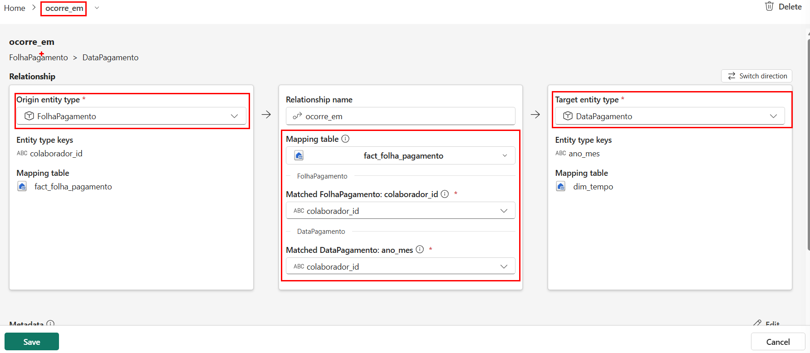</p>

8. Volte para **Home** e confirme que as três entidades e os dois relacionamentos aparecem no canvas.

<p align="center">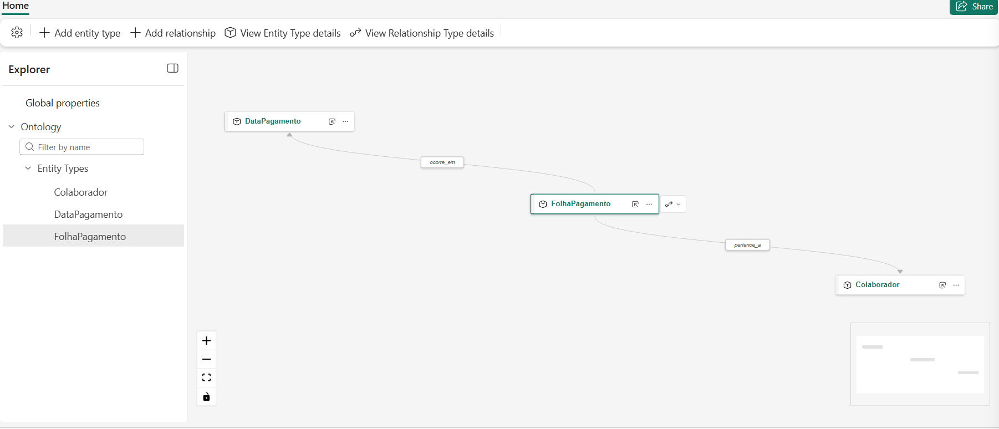</p>

**Se algo não funcionar corretamente:**
- Se uma tabela não aparecer na seleção, confirme que ela existe no schema `gold` como tabela gerenciada do Lakehouse.
- Se uma entidade aparecer sem dados, revise o data binding, a tabela selecionada e o acesso ao Lakehouse.
- Neste recorte do lab, `colaborador_id` identifica os registros disponíveis em `FolhaPagamento`. Se futuramente ele deixar de ser único, crie no Passo 08 uma coluna string `folha_id`, atualize a tabela `gold` e use essa nova coluna como chave.
- Se valores monetários aparecerem como `null` no grafo, confira o tipo das colunas. O Fabric Graph não suporta `Decimal`; use `Double` para `salario_bruto`, `descontos` e `salario_liquido` antes de recriar/atualizar o binding.

**Critério de saída da Etapa 1:** `ContosoRH_Ontology` criada, com três entidades, chaves válidas, propriedades vinculadas e dois relacionamentos configurados.

---

### Etapa 2 — Visualizando e consultando a ontologia

#### 1. Veja as instâncias das entidades

Quando os bindings são configurados, cada linha das tabelas `gold` se torna uma **instância** da entidade correspondente.

1. No canvas **Home**, selecione a entidade `Colaborador` e escolha **View Entity Type details**. Na página de detalhes, clique na aba **Instances**.

<p align="center">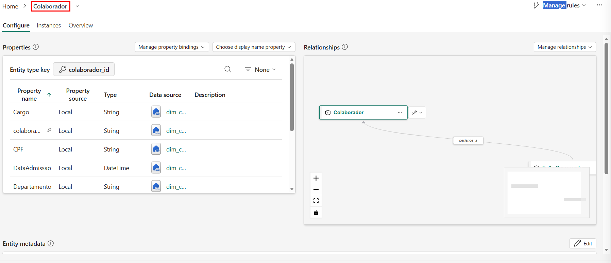</p>

2. Confirme que as linhas de `gold.dim_colaborador` aparecem com `colaborador_id`, `Matricula`, `Nome`, `Cargo`, `Departamento`, `Pais` e `Status`.

#### 2. Explore o grafo de relacionamentos

1. Com a entidade `Colaborador` selecionada, abra a aba **Overview**.
2. No card **Relationship graph**, selecione **Expand**. Explore também os demais gráficos e cards da página, que apresentam distribuições e contagens das propriedades disponíveis para a entidade.

<table>
    <tr>
        <td>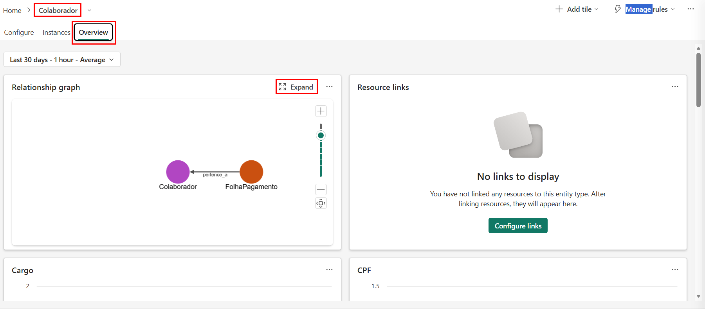</td>
        <td>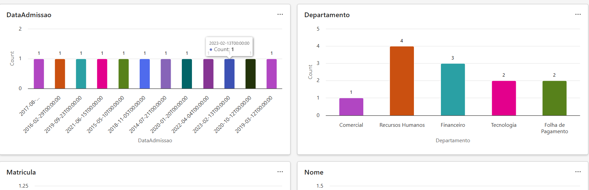</td>
    </tr>
    <tr>
        <td align="center"><em>Relationship graph</em></td>
        <td align="center"><em>Outros gráficos e informações</em></td>
    </tr>
</table>

3. No grafo expandido, confirme o caminho disponível para a entidade em teste:
     - `FolhaPagamento` → `pertence_a` → `Colaborador`.

4. Explore a interface do grafo:
     - clique no nó **Colaborador** para visualizar mais informações e as ações disponíveis para a entidade;
     - selecione **Run query** para executar a consulta padrão e carregar as instâncias e suas conexões;
     - após a execução, clique no botão de **maximizar os resultados da query**, no canto superior direito da área de resultados, para melhorar a visualização.

<table>
    <tr>
        <td>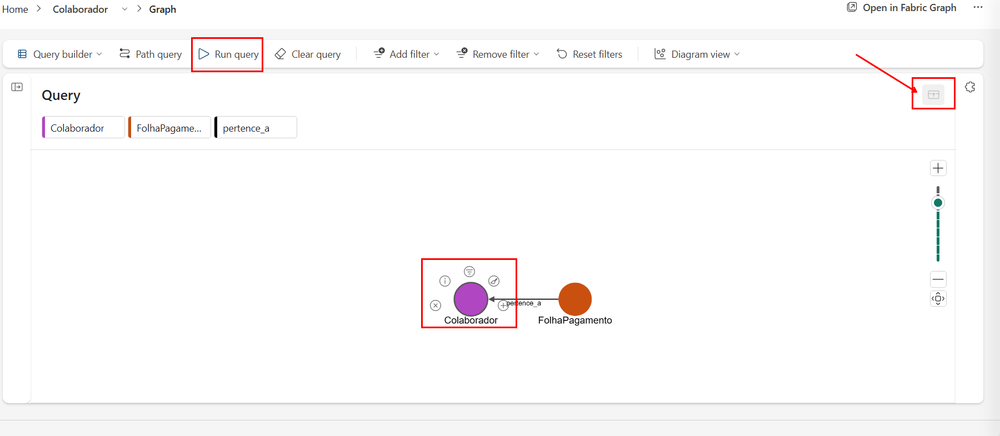</td>
        <td>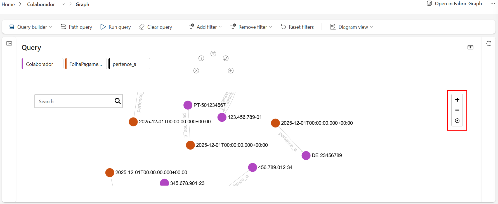</td>
    </tr>
    <tr>
        <td align="center"><em>Explorando interface e início de query</em></td>
        <td align="center"><em>Run query e maximização dos resultados</em></td>
    </tr>
</table>

> Se o resultado estiver vazio ou muito esparso, revise as chaves das entidades e as colunas configuradas em **Matched** nos relacionamentos.

#### 3. Consulte o grafo com o Query builder

O **Query builder** permite refinar o grafo sem escrever código. Como exemplo, vamos iniciar um filtro na entidade `Colaborador`.

1. Clique no nó `Colaborador` dentro da área **Query** e selecione **Add filter**.
2. Escolha uma propriedade, como `Pais`, configure o valor desejado (por exemplo, `Brasil`) e execute novamente com **Run query**.
3. A partir desse exemplo, explore livremente a interface: adicione outros filtros, novos nós e relacionamentos ao grafo para responder diferentes perguntas sobre os dados.
4. Use **Clear query** para limpar a consulta antes de criar um novo teste.

<p align="center">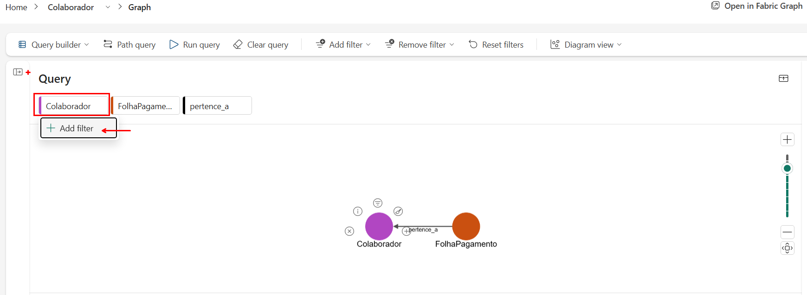</p>

> **Fora do escopo:** não usaremos séries temporais com Eventhouse neste lab porque nossas três tabelas `gold` contêm dados estáticos, não telemetria em streaming.

> **Refresh:** alterações feitas posteriormente nas tabelas de origem não aparecem automaticamente no grafo. Use a opção de **refresh do graph model** antes de validar dados atualizados.

**Critério de saída da Etapa 2:** as instâncias de `Colaborador` estão visíveis, o relacionamento `pertence_a` aparece no grafo, a consulta padrão foi executada e um filtro foi configurado no Query builder.

---

### Etapa 3 — Consumindo a ontologia com Fabric Data Agent

#### 1. Crie o Data Agent

1. Volte ao workspace `Contoso-RH-Lab03`.
2. Selecione **+ New item → Data agent**.
3. Informe o nome **`ContosoRH_OntologyAgent`** e crie o item.

<p align="center">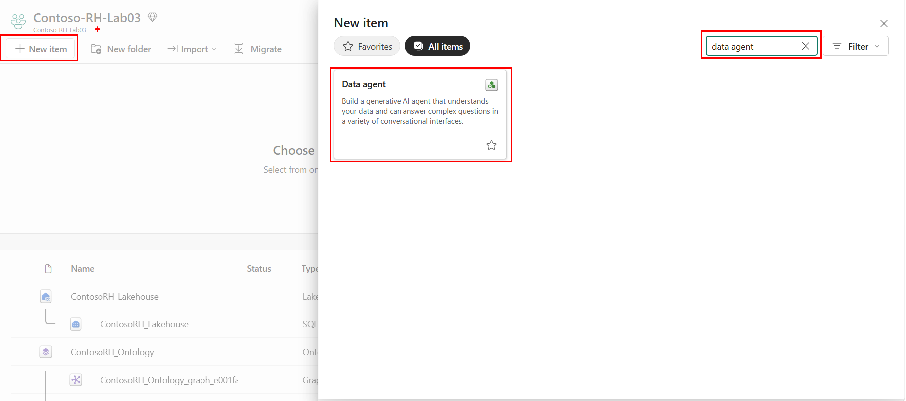</p>

> **Atenção:** se o item **Data agent** não estiver disponível, confirme com o administrador se os tenant settings de Ontology, Copilot e Azure OpenAI estão habilitados.

#### 2. Adicione a ontologia como fonte

1. Quando o agente abrir, selecione **Add a data source / Adicionar uma fonte de dados**.

<p align="center">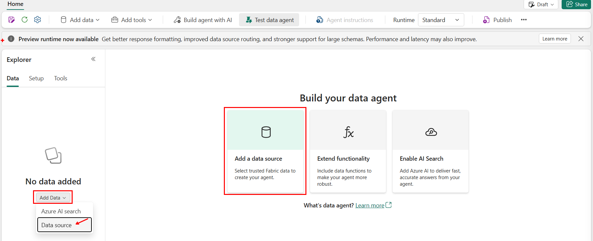</p>

2. Pesquise por **`ContosoRH_Ontology`**, selecione o item e escolha **Add**.
3. Aguarde a inicialização e confirme no **Explorer** que `Colaborador`, `DataPagamento` e `FolhaPagamento` aparecem como entidades disponíveis.

<p align="center">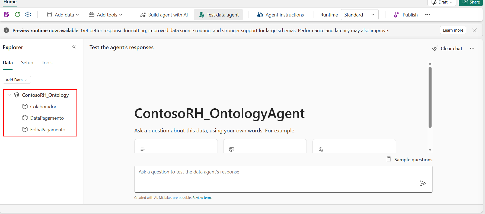</p>

#### 3. Configure as instruções do agente

1. Na faixa de opções, selecione **Agent instructions**.
2. Ao final das instruções existentes, adicione:

```text
Support group by in GQL

Use os nomes e relacionamentos definidos na ontologia da Contoso RH.
Ao responder sobre folha de pagamento, informe a competência considerada.
Não invente dados, entidades ou relacionamentos que não estejam disponíveis na ontologia.
```

> A instrução `Support group by in GQL` melhora consultas com agregações sobre a ontologia.

<p align="center">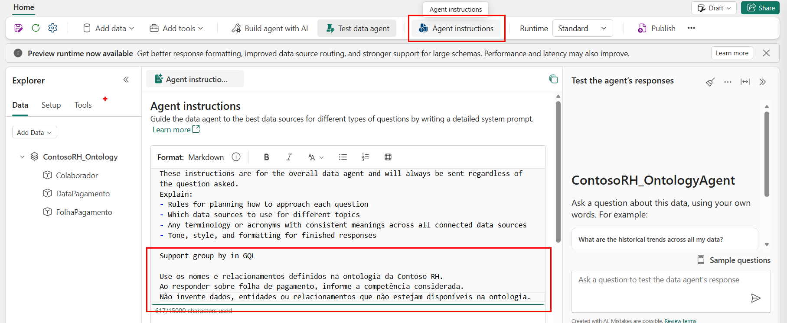</p>

#### 4. Faça perguntas em linguagem natural

Teste os prompts abaixo, um de cada vez:

1. *"Qual é o total de salário bruto por país?"*
2. *"Para cada colaborador, mostre salário bruto, descontos e salário líquido na competência 2025-12."*
3. *"Quais colaboradores do Brasil tiveram salário líquido maior que 6.000 na competência 2025-12?"*
4. *"Qual departamento possui o maior salário líquido total?"*

Verifique se as respostas usam os conceitos `Colaborador`, `FolhaPagamento`, `DataPagamento` e seus relacionamentos, em vez de expor apenas nomes técnicos de tabelas.

Após receber uma resposta, expanda **steps completed** para explorar como o agente interpretou a pergunta. Analise o raciocínio apresentado, a consulta **GQL** gerada, as entidades e os relacionamentos utilizados e o output retornado. Essa inspeção ajuda a validar se a ontologia está sendo consumida como esperado.

<table>
    <tr>
        <td>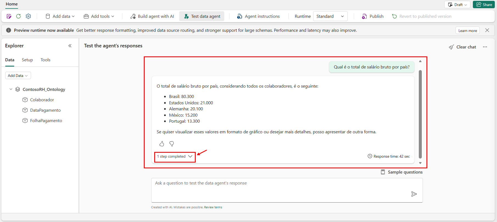</td>
        <td>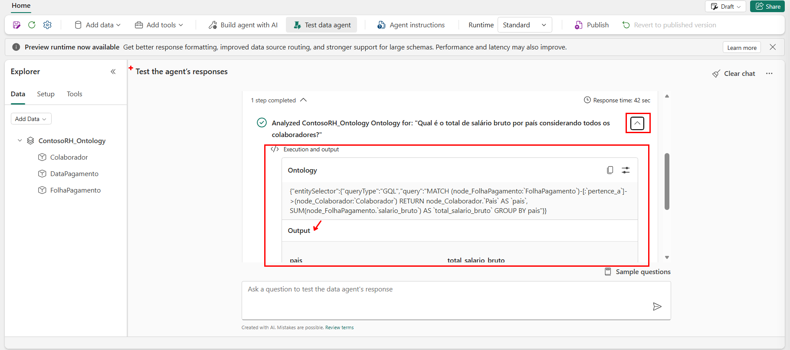</td>
    </tr>
    <tr>
        <td align="center"><em>Resposta e passos concluídos</em></td>
        <td align="center"><em>Consulta executada e output</em></td>
    </tr>
</table>

> Se o agente responder que não há dados logo após a criação, aguarde alguns minutos para a inicialização e tente novamente. Não teste perguntas sobre férias, reembolsos ou IRRF neste momento: essas entidades ainda não existem nas três tabelas da camada `gold` usadas pela ontologia.

#### 5. Customize e publique o Data Agent

O Data Agent pode evoluir além deste exemplo básico. Explore as opções disponíveis para:

- adicionar outras **fontes de dados** pelo menu **Add data**;
- escrever **Agent instructions** mais completas, com regras de negócio, terminologia, formato e tom das respostas;
- adicionar **tools** para ampliar as ações que o agente pode executar;
- usar **Build agent with AI** para auxiliar na configuração e evolução do agente;
- selecionar e testar diferentes opções de **runtime**, quando disponíveis no tenant.

Quando os testes estiverem concluídos, selecione **Publish**. A publicação cria uma versão estável do agente para consumo e compartilhamento. De forma simplificada, e sempre respeitando as permissões, identidade, acesso aos dados e políticas de governança da organização, o agente publicado pode ser integrado a experiências como **Microsoft Teams** e **Microsoft 365**, ou exposto por uma integração baseada em **HTTPS endpoint** para consumo por outras aplicações.

> A disponibilidade de canais e endpoints depende das integrações, licenças e configurações habilitadas no seu tenant. Publicar não torna os dados públicos nem remove as regras de acesso existentes.

<p align="center">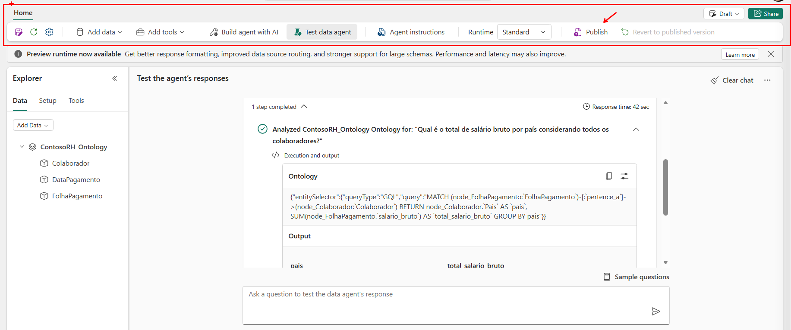</p>

**Armadilhas comuns:**
- Vincular uma entidade à tabela ou à chave errada → as instâncias podem não carregar ou ficar desconectadas.
- Ignorar chaves ausentes → as instâncias aparecem sem conexões ou o grafo fica vazio.
- Selecionar colunas **Matched** incompatíveis → o relacionamento existe no canvas, mas não conecta instâncias.
- Consultar o Data Agent antes da inicialização ou antes do refresh do grafo → respostas podem indicar que não há dados.

**Critério de saída do Passo 10:** `ContosoRH_Ontology` possui três entidades e dois relacionamentos navegáveis; o grafo retorna uma consulta filtrada; e `ContosoRH_OntologyAgent` responde perguntas usando o contexto da ontologia, permite inspecionar a consulta executada e possui uma versão publicada. **(~25–35 min)**

---

## Passo 11 — Valide e feche

**Objetivo:** validar os artefatos produzidos no lab e preparar o hand-off para os próximos cenários.

**Pré-requisitos:** Lakehouse, notebook, modelo semântico, relatório, ontologia e Data Agent concluídos.

**Ações detalhadas:**
1. Confirme que `ContosoRH_Report` está salvo e usa o `ContosoRH_SemanticModel`.
2. Abra `ContosoRH_Ontology` e valide:
    - três entidades com instâncias: `Colaborador`, `DataPagamento` e `FolhaPagamento`;
    - dois relacionamentos navegáveis: `pertence_a` e `ocorre_em`;
    - uma consulta visual filtrada por `Pais = Brasil` executada com sucesso.
3. Abra `ContosoRH_OntologyAgent` e valide pelo menos duas perguntas:
    - total de salário bruto por país;
    - detalhes de salário bruto, descontos e salário líquido por colaborador na competência `2025-12`.
4. Expanda os passos de uma resposta e confirme que a consulta GQL utiliza as entidades e o relacionamento esperados.
5. Confirme que o Data Agent foi publicado e registre o hand-off: o Lakehouse, o modelo semântico e a ontologia passam a ser a base governada para novos relatórios, agentes e automações.

**Armadilhas comuns:**
- Validar apenas o relatório e não verificar as instâncias/relações da ontologia.
- Fazer perguntas sobre domínios que ainda não foram materializados na camada `gold`.
- Esquecer de atualizar o grafo depois de alterar as tabelas ou bindings.

**Critério de saída:** relatório salvo, ontologia navegável, consulta visual executada, Data Agent respondendo com contexto, consulta GQL inspecionada, agente publicado e hand-off registrado. **(~8 min)**

---

## ✅ Checklist final dos critérios de saída

- [ ] 01 — Cenário compreendido: três módulos convergem em um único Lakehouse pela `Matricula`.
- [ ] 02 — Workspace `Contoso-RH-Lab03` criado com Fabric capacity associada.
- [ ] 03 — `ContosoRH_Lakehouse` criado com suporte a schemas.
- [ ] 04 — Estratégia registrada: Mirroring ingere na Bronze e ETL/Notebook transforma Silver/Gold.
- [ ] 05 — Se o Lab 02 foi realizado, tabelas dos três bancos ingeridas na Bronze.
- [ ] 06 — Caso alternativo concluído: 10 arquivos CSV enviados para **Files**, sem o `README.md`.
- [ ] 07 — Schemas `bronze`, `silver` e `gold` criados; 10 CSVs carregados como tabelas Delta em `bronze`.
- [ ] 08 — `ContosoRH_Notebook` executado: tabelas `silver` criadas e `dim_colaborador`, `dim_tempo` e `fact_folha_pagamento` materializadas em `gold`.
- [ ] 09 — `ContosoRH_SemanticModel` relacionado, `ContosoRH_Report` criado com visualizações e salvo.
- [ ] 10 — `ContosoRH_Ontology` criada com três entidades e dois relacionamentos; instâncias e grafo consultados; filtro testado; `ContosoRH_OntologyAgent` configurado, testado, inspecionado e publicado.
- [ ] 11 — Relatório, ontologia, consulta GQL e agente validados; publicação do agente e hand-off confirmados.

---

**Versão:** 1.0 · **Mantido por:** Thaise Batista e João Pedro Peira | tbatista@microsoft.com / jpeira@microsoft.com
